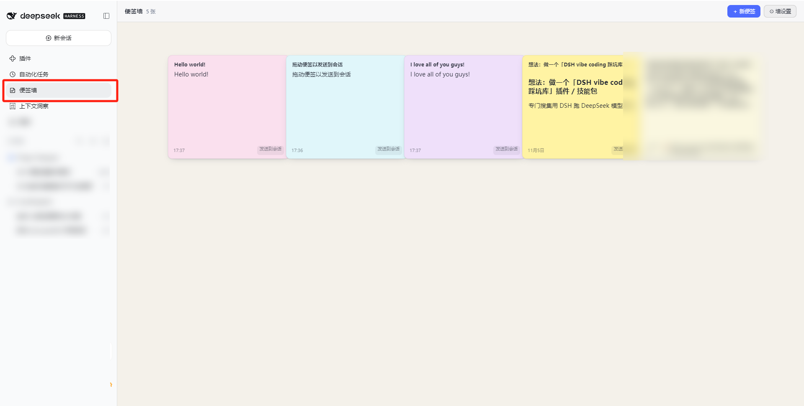
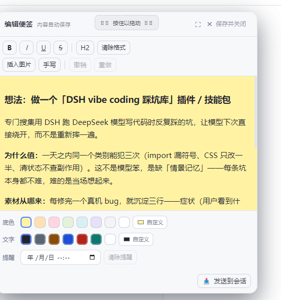
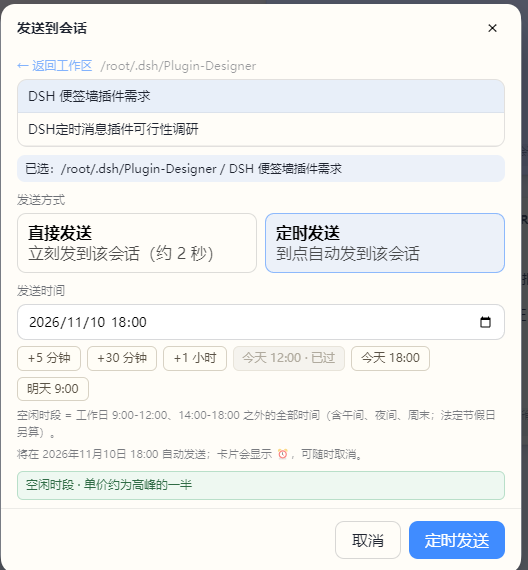

# NoteWall

[中文](README.md) · **English** · v0.3.0

A sticky-note wall for DeepSeek Harness. Jot from the sidebar, drag into a conversation when you need it.



## Notes inside a conversation

**You're mid-reply and remember something else. No need to leave.**

Click the 📝 button in the session header and the whole wall pops up. Pick a note and it opens in a floating window you can drag anywhere by its title bar — it never covers your text.

When you're done, hit **Send to conversation** at the bottom, pick the target session, send it now or schedule it, and the window closes itself. You never leave the conversation you were in.

- **Drag by the title bar** — the handle sits in the middle, showing ⠿⠿ Press and drag ⠿⠿
- **⛶ Fullscreen** — expand the panel when a note gets long
- The floating window is the same editor as the wall: rich text, inline images, drawing pad, autosave



## Scheduled delivery

**A note can be a letter to a session in the future.**

Open a note → **Send to conversation** → pick a session → switch to **Schedule** and choose a time. When the time comes, the content arrives in that session as a message. You don't have to be at the screen.



- **12:00 / 18:00 shortcuts** — those are when DeepSeek's off-peak pricing starts. One click puts your note in a half-price window.
- **Past times are rejected** — you get an explicit error instead of a silent no-op.
- **Visible on the card** — a scheduled note shows ⏰ and its time, and can be cancelled any time.
- The same dialog also does **send now** (arrives in about 2 seconds).

Paired with the kernel's scheduler, a note can wake a cold session — that's the real difference from copy-paste.

## Everything else

**Writing**
- Rich text (bold / italic / lists / headings) + images anywhere + a drawing pad, with 400ms debounced autosave.
- New notes step through hues by the **golden angle 137.5°**, so neighbours stay distinct and the wall keeps even brightness without collisions.

**Browsing**
- A grid ordered by creation time, pinned notes first; cards show a collapsed preview and expand on click.
- Hover magnification scales text and preview together.

**Organising**
- Drag to reorder: a blue insertion line appears between cards and the rest slide out of the way.
- Wall settings: solid / image (with overlay) / transparent background, columns, card size, gaps, font size, hover scale, new-note palette.
- Bilingual UI: follows the browser language, or lock it under **Wall settings → Language**.

## Install

```bash
git clone https://github.com/liaoangbo-droid/dsh-notewall.git
cd dsh-notewall
dsh plugin --profile web add "$PWD"
# restart the DSH kernel (host plugins have no hot reload)
```

`lib/client.js` ships with the repo — **you don't need to build**. Only after editing `client/` sources do you run `node scripts/build-client.mjs` and refresh the page.

## Model tools

| Tool | Purpose |
|---|---|
| `sticky_note_create` | Create a note (**ask the user first**) |
| `sticky_note_list` | List notes (read-only) |
| `sticky_note_update` | Edit text / colour / pin / reminder time |
| `sticky_note_delete` | Delete a note (**ask the user first**) |

Creating and deleting are user-visible side effects. The tool descriptions say "ask first", and there is no silent path in the implementation.

## Known limitations

- Alarms need a browser tab: nothing fires while the page is fully closed, and missed ones pop up on reopen.
- Hover magnification is mouse-only; on touch devices a tap goes straight into the editor.
- "Send now" goes through the kernel scheduler (`at = now + 1500ms`), so it lands after roughly 2 seconds — a deliberate margin.
- The in-conversation draft floats above the session instead of squeezing the message body. Squeezing would mean implementing a whole custom layout system; not worth it.
- Every route (reads included) passes the kernel trust fence `ctx.connection.requestRejection(req)`: mismatched Host/Origin gets 403 (blocks DNS rebinding and cross-site calls), missing auth cookie gets 401. Plain `curl` failing is expected. The server also binds `127.0.0.1` only.
- Note content is restricted HTML — no tables or code blocks, and `script`/`style`/`iframe`/`on*` are stripped host-side.

## License

MIT · See [Releases](https://github.com/liaoangbo-droid/dsh-notewall/releases) for changes
