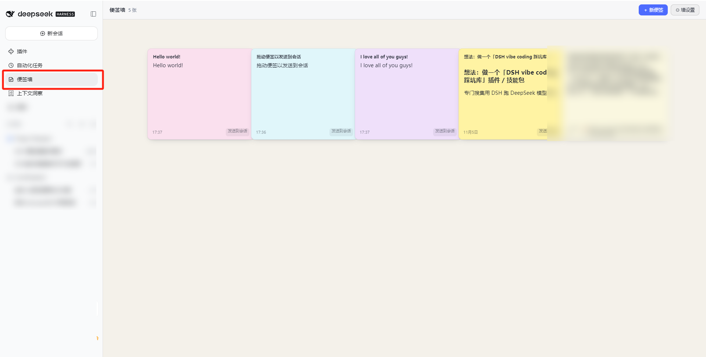
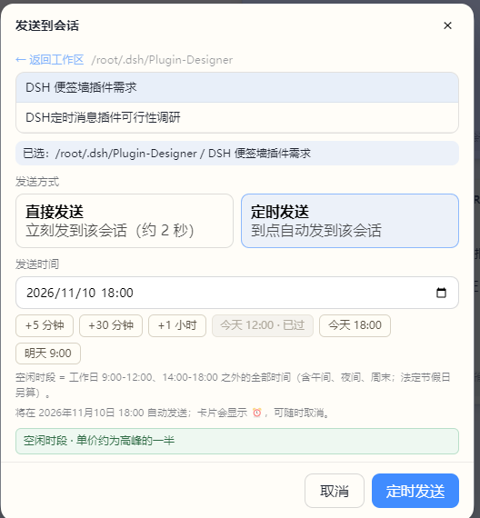

# NoteWall · 便签墙

[English](README.en.md) · **中文**

给 DeepSeek Harness 的便签墙。从左侧栏随手记，想起来了拖进会话。



## 定时发送

**便签可以是写给未来某个会话的信。**

点便签右下角「发送到会话」→ 选目标会话 → 切到**定时发送**，挑一个时间点。到点后，内容自动作为一条消息进入那个会话，你不用守在屏幕前。



- **12:00 / 18:00 快捷按钮**：这两个时刻是 DeepSeek 空闲计费时段的起点。点一下就能把便签排在半价时段。
- **早于当前会被拦下**：选过去的时间不会静默失败，直接提示重选。
- **卡片上看得见**：排上的便签显示 ⏰ 和预约时间，随时可以取消。
- 同一个入口也支持**立即发送**（约 2 秒后到达），随手转发也能用。

配合内核的定时器，便签能在会话冷着的时候把它唤醒——这是它和普通复制粘贴最大的区别。

## 其他功能

**记**
- 富文本（粗体/斜体/列表/标题）+ 图片任意位置插入 + 手写画板，防抖 400ms 自动保存。
- 新建便签按**黄金角 137.5°** 递进配色，相邻两张色相拉得开，整墙明度一致，且不会撞色。

**看**
- 网格墙按创建时间排布，置顶的排最前；卡片折叠预览，点击展开。
- 鼠标停留放大，字号与预览区一起变高。

**整理**
- 拖动排序：两卡之间出现蓝色插入线，其余卡片平滑让位。
- 墙设置：背景纯色/图片（带遮罩）/透明，同屏列数、卡片宽高、间距、字号、hover 倍率、新建便签配色。
- 中英文界面：跟随浏览器语言，也可在「墙设置 → 语言」手动锁定。

## 安装

```bash
git clone https://github.com/liaoangbo-droid/dsh-notewall.git
cd dsh-notewall
dsh plugin --profile web add "$PWD"
# 重启 DSH 内核（host 插件无热加载）
```

`lib/client.js` 已随仓库提供，**不需要自己构建**；只有改了 `client/` 源码才需要 `node scripts/build-client.mjs` 后刷新页面。

## 模型工具

| 工具 | 用途 |
|---|---|
| `sticky_note_create` | 新建便签（**必须先征得用户同意**） |
| `sticky_note_list` | 列出便签（只读） |
| `sticky_note_update` | 改正文 / 颜色 / 置顶 / 提醒时间 |
| `sticky_note_delete` | 删除便签（**必须先征得用户同意**） |

创建和删除是用户可见的副作用，工具描述里写明了「先问用户」，实现上也没有静默路径。

## 已知限制

- 闹钟依赖浏览器打开：页面全关时不会响，重开会补弹。
- hover 放大只在鼠标悬停时触发；触屏设备点击直接进编辑。
- 立即发送走内核定时器（`at = now + 1500ms`），所以有约 2 秒延迟——这是刻意留的余量。
- 只读接口（`GET /state`、`/media/*`）无鉴权，服务默认只监听 `127.0.0.1`；若要挂反向代理，鉴权得在代理侧补。
- 便签内容是不含表格与代码块的受限 HTML（`script`/`style`/`iframe`/`on*` 已在 host 侧剥离）。

## License

MIT · 更新见 [Releases](https://github.com/liaoangbo-droid/dsh-notewall/releases)
